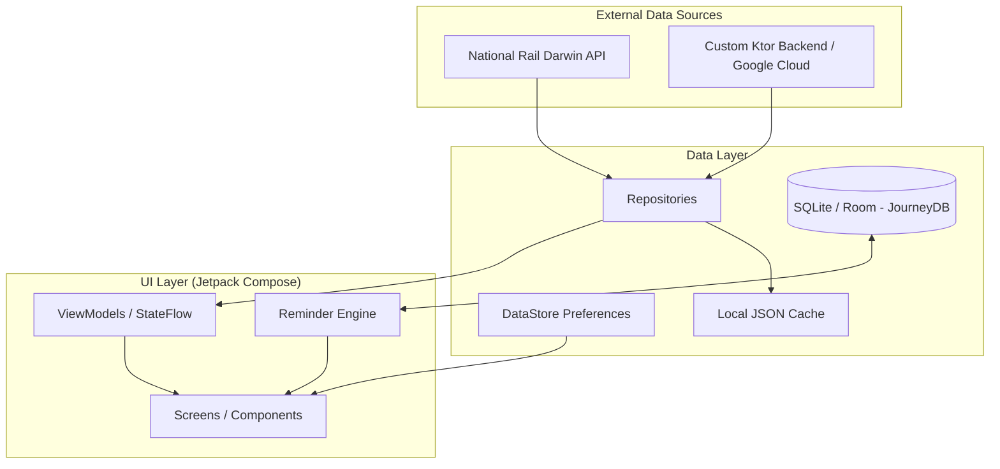

# Transit Mate: Advanced UK Rail Intelligence

Transit Mate is a high-performance Android application designed to provide comprehensive, real-time intelligence for the United Kingdom's railway network. Built with a focus on data integrity, privacy, and minimalist design, it serves as a sophisticated companion for both daily commuters and long-distance travelers.

The application leverages direct feeds from National Rail and a custom-built infrastructure to deliver precise timing, platform information, and service disruptions across more than 2,500 stations.

---

## Visual Interface

|                                                  Real-Time Live Boards                                                   |                                                  A-to-B Journey Planning                                                  |
|:------------------------------------------------------------------------------------------------------------------------:|:-------------------------------------------------------------------------------------------------------------------------:|
|  |  |

---

## Architecture and Data Flow

Transit Mate utilizes a modern, reactive architecture built on Jetpack Compose and Kotlin Coroutines. The project is structured using a multi-module approach to ensure scalability and maintainability.

---

## Key Capabilities

### Real-Time Station Intelligence
*   **Live Boards:** High-frequency data streams provide up-to-the-minute departure and arrival information.
*   **Platform Tracking:** Stay informed with precise platform assignments and real-time updates on changes.
*   **Calling Patterns:** View full service schedules including every intermediate stop and timing.

### Journey Planning and Timetables
*   **A-to-B Planner:** A robust engine for planning direct routes between any two stations in the UK.
*   **National Timetable:** Instant access to the complete schedule for the entire network, supporting historical and future service lookups.

### Regulatory and Ticketing Information
*   **Ticket Encyclopedia:** Clear explanations of advance, off-peak, and anytime ticket categories.
*   **Restriction Intelligence:** Direct access to detailed validity rules and easement conditions to ensure compliance with official terms.

### Smart Reminder Engine
*   **Deterministic Alerts:** Local notification system powered by a robust SQLite backend.
*   **Exact Alarms:** Utilizes Android's `BroadcastReceiver` and `AlarmManager` for precise, minute-perfect reminders before departure.

---

## Technical Specifications

Transit Mate is developed using the industry-standard "Gold Standard" for modern Android development:

*   **Language:** 100% Pure Kotlin.
*   **Backend:** Custom Ktor service hosted on Google Cloud Platform (GCP).
*   **UI Framework:** Jetpack Compose (Declarative UI).
*   **Navigation:** Navigation3 for sophisticated backstack management.
*   **Concurrency:** Kotlin Coroutines and Flow for reactive data streams.
*   **Dependency Injection:** Hilt (Dagger) for robust dependency management.
*   **Persistence:** Room/SQLite for local database and DataStore for preferences.
*   **Security:** Firebase App Check and Google Cloud protection.

---

## Implementation Details

### Theme and Design
The application features a minimalist monochrome design language. The primary palette is restricted to pure Black and White, utilizing subtle surface elevations and outlines to create hierarchy without visual clutter. Functional colors (Success Green, Warning Orange, and Error Red) are reserved strictly for critical status information to maximize readability.

### Privacy Policy
Transit Mate operates on a "Zero Analytics" philosophy. There is no user account requirement, no tracking, and absolutely no data collection. All journey data and reminders are stored locally on the device.

---

## Availability

Transit Mate is available for download on the [Google Play Store](https://play.google.com/store/apps/details?id=com.das.transitMate).

---
*Developed with precision for the United Kingdom rail commuter.*
